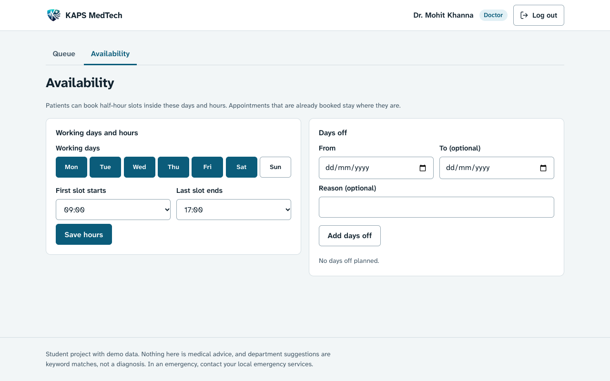
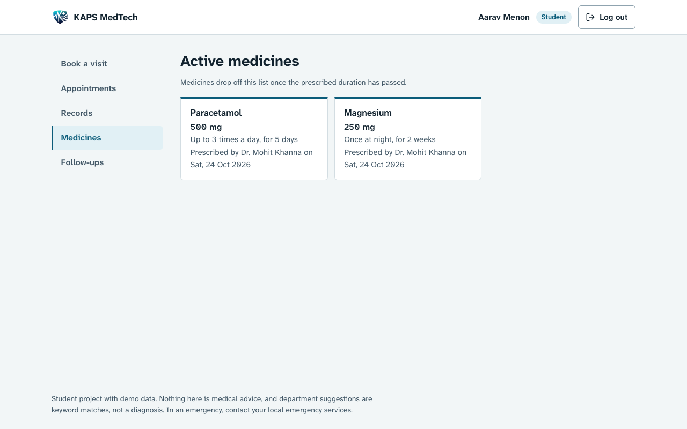

# KAPS MedTech

[](https://github.com/pushpam2404/KAPS-Medtech/actions/workflows/ci.yml)

A university clinic booking app. Students and staff pick a reason for a visit, a department, a doctor and a half-hour slot. Doctors work through a queue, record a diagnosis and prescriptions, and the patient sees the result in their account. It is a course project, built with Express, PostgreSQL and plain JavaScript.

Hosted copy: https://kaps-medtech.vercel.app. It runs on free tiers. The database behind it can be paused or removed, and `/api/health` on that URL shows whether it is reachable. At the last check (26 October 2026) the database was gone; [docs/DEPLOYMENT.md](docs/DEPLOYMENT.md) explains how to bring up a new one.


## Not for real patients

This is a student project with fictional demo data. It gives no medical advice and is not a medical device. The department suggestion on the booking page is a keyword lookup against a list of symptom names, not a diagnosis. If you or someone else needs urgent care, contact your local emergency services. Do not put real patient records into a deployment of this code without a proper review of security, privacy law and hosting.

## What it does

Students and staff book with a doctor in three steps. While they type a reason, the page suggests a department and warns if they choose a different one. Each doctor card shows the days and hours that doctor works, and the time picker only offers slots inside them. Patients can list and filter their appointments, reschedule or cancel a booked one, open the record of a finished visit (with any attached report), see the medicines that are still running (a prescription drops off the list when its duration ends) and see upcoming follow-up dates.

Doctors see their booked appointments grouped by day. Starting a visit shows the patient's earlier records. The treatment form takes a diagnosis, advice, a follow-up date, up to 20 prescriptions and an optional PNG, JPEG, WebP, GIF or PDF report up to 2 MB. Saving it marks the visit complete. Doctors can also cancel an appointment. On the Availability tab they set their working days and hours and add blocks of days off; bookings that already exist are kept and the doctor is told how many fall outside the new settings. Patient lookups, saved records and doctor cancellations are written to an audit table.

| Booking | Appointments on a phone |
| --- | --- |
|  |  |

| Doctor queue | Availability |
| --- | --- |
|  |  |

| Treatment form | Records and medicines |
| --- | --- |
|  |  |

## How it is put together

The Express server in `backend/` serves the API under `/api` and the static pages in `frontend/`. There is no frontend build step. PostgreSQL holds six tables: users, doctors, symptoms, appointments, medical records and prescriptions. Logins use bcrypt-hashed passwords and one-hour JWTs.

Two decisions are worth knowing about. Double bookings are prevented by a partial unique index in the database, not by a check in the route, so simultaneous requests cannot both succeed. Doctor accounts can read patient details, so a doctor only sees patients who have booked with them, and doctor sign-up needs a registration code set on the server.

[docs/ARCHITECTURE.md](docs/ARCHITECTURE.md) has the file layout, access rules and known limits. [docs/API.md](docs/API.md) lists every endpoint.

## Run it locally

You need Node 22 or newer and a PostgreSQL database (a local one, or a free Neon project).

```bash
git clone https://github.com/pushpam2404/KAPS-Medtech.git
cd KAPS-Medtech
npm ci
cp .env.example backend/.env     # then fill in DATABASE_URL and JWT_SECRET
npm run db:reset:demo            # tables, doctors, symptoms and a demo clinic's worth of data
npm start                        # http://localhost:3001
```

The sign-in page then shows the demo accounts as one-click buttons.

`npm run db:init` creates only the tables, the 65 seeded doctors and the symptom list. `npm run db:seed:demo` adds the demo patients and visits to a database that has the schema (or to an empty one) and can be run repeatedly. `npm run db:migrate` upgrades an older database without dropping anything. Every command that loads `schema.sql` drops existing tables, so use an empty database.

Environment variables (see `.env.example`):

| Variable | Needed | Purpose |
| --- | --- | --- |
| `DATABASE_URL` | yes | PostgreSQL connection string |
| `JWT_SECRET` | yes | signing key for login tokens; use a long random value |
| `PORT` | no | defaults to 3001 |
| `DOCTOR_SIGNUP_CODE` | no | doctors can register themselves only if this is set, and must enter it |
| `ALLOWED_ORIGINS` | no | comma-separated origins for cross-site API calls |
| `DATABASE_SSL` | no | `verify` (default whenever SSL is used), `relaxed` (encrypt, skip the certificate check) or `off` |
| `DATABASE_CA` | no | PEM text of an extra CA to trust, for a private CA such as Supabase's pooler |
| `DEMO_MODE` | no | `off` hides the demo accounts on the sign-in page |
| `ALLOW_DEMO_SEED` | no | `1` lets the demo seed commands run when `NODE_ENV=production` |

## Demo accounts

Every demo account uses the password `password123`.

| Role | Name | Email |
| --- | --- | --- |
| Student patient | Aarav Menon | `aarav.menon@example.edu` |
| Staff patient | Meera Nair | `meera.nair@example.edu` |
| Doctor, neurology | Dr. Mohit Khanna | `neuro1@health.edu` |
| Doctor, cardiology | Dr. Arjun Patel | `cardio1@health.edu` |
| Doctor, general medicine | Dr. Anil Sharma | `gp1@health.edu` |

Those are the roles the app has: student, staff and doctor. The seeded doctors in every department follow the pattern `gp1`, `cardio1`, `pulmo1`, `gas1`, `neuro1`, `ortho1`, `derma1`, `psy1`, `ent1`, `eye1`, `endo1`, `neph1`, `dent1` at `@health.edu`, with numbers 1 to 5 in each.

The demo seed gives Aarav and Meera finished visits with diagnoses, prescriptions and generated sample reports (a small chart image and a PDF), medicines that are still running and some that have ended, follow-up dates, upcoming bookings and a cancelled one. Dr. Khanna has six booked patients today. Dr. Patel works Tuesday to Saturday, 10:00 to 16:00, with a block of days off next week; Dr. Menon (orthopedics) sees patients on Monday, Wednesday and Friday. Six more patients fill the queues. Dates are relative to the day you seed, so run `npm run db:seed:demo` again if the data has gone stale.

Doctor sign-up still needs `DOCTOR_SIGNUP_CODE`. The demo doctors do not, because they come from the seed.

## Tests

```bash
npm test                         # unit tests for slots, availability, durations, symptom matching, input checks and TLS settings
DATABASE_URL=postgresql://... npm run test:integration
```

The integration suite starts the app on a random port and runs against whatever database `DATABASE_URL` points to, after `npm run db:init`. It covers sign-up and login rules, booking, rescheduling and patient cancellation, four simultaneous bookings of one slot, doctor access limits, record validation, availability and days off, and running the demo seed twice. It adds test users and appointments, so do not point it at a database you care about. GitHub Actions runs both suites against PostgreSQL 16 on every push (`.github/workflows/ci.yml`).

## Deploying

[docs/DEPLOYMENT.md](docs/DEPLOYMENT.md) covers a fresh free Neon database (`scripts/setup-neon.sh`) and Vercel. Set `JWT_SECRET` and `DATABASE_URL` as environment variables there, never in the repository.

## Limitations

- Every doctor's slots are half an hour long, and a doctor has one set of working hours for all their working days.
- The rate limiter keeps its counts in memory, so on serverless hosting it only slows guessing down.
- Reports are stored as base64 text in the database, and the login token is kept in `localStorage`, so a script-injection bug would expose it. Output is escaped and a Content-Security-Policy is sent, but httpOnly cookies would be safer. I left the token where it is because moving it touches every request and was not worth the risk here.
- There is no email or SMS reminder, no password reset, and no screen for reading the audit table.
- Hosted databases are connected with certificate verification. Neon works as is; Supabase's pooler needs `DATABASE_CA` or `DATABASE_SSL=relaxed`.
- The demo password is shared and public. Set `DEMO_MODE=off` and remove the demo accounts before any real use.

## License

MIT, see [LICENSE](LICENSE).
