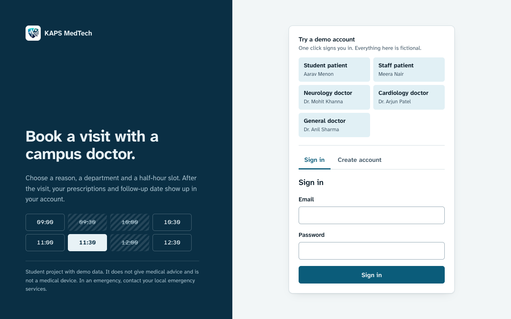
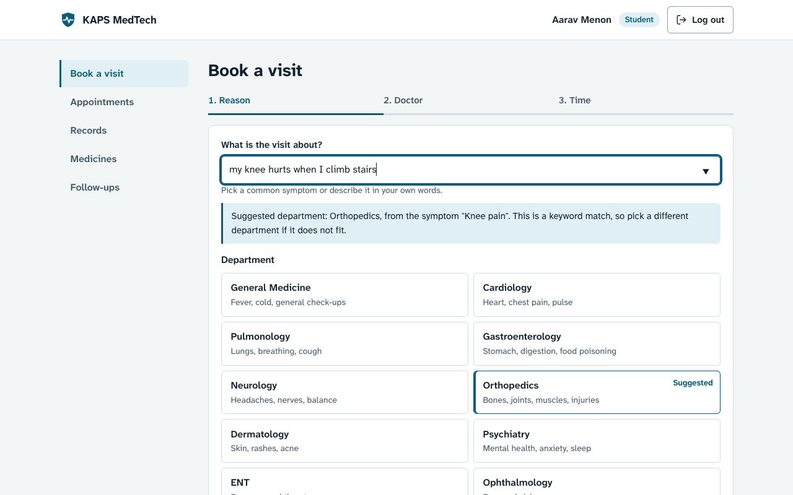
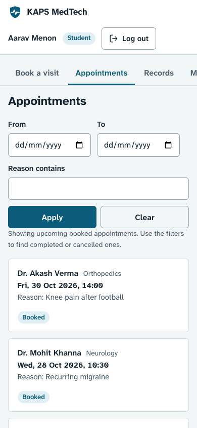
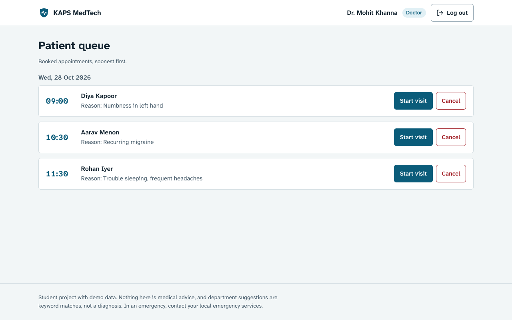
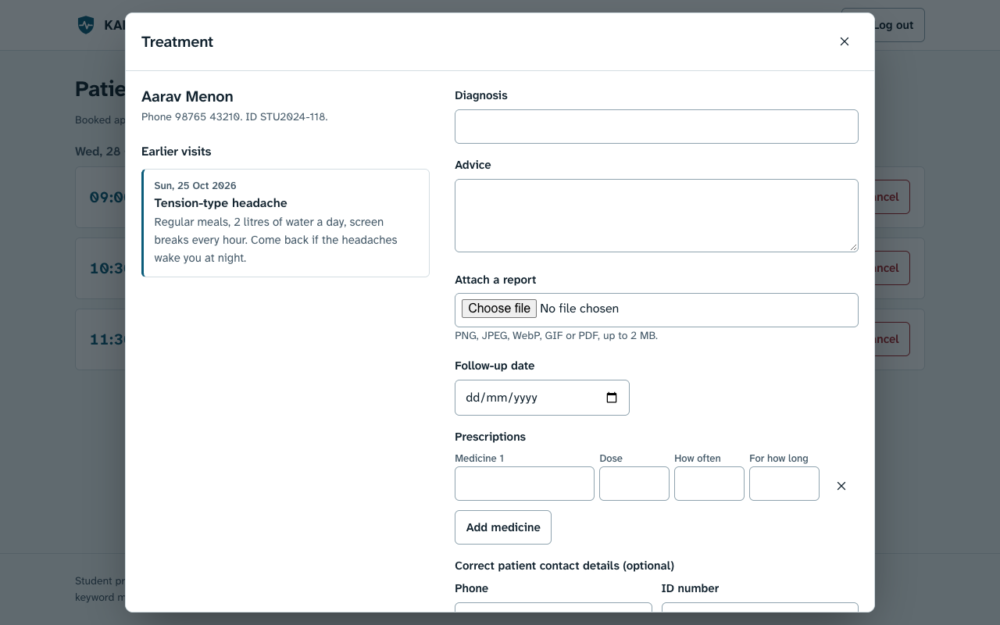

# KAPS MedTech

[](https://github.com/pushpam2404/KAPS-Medtech/actions/workflows/ci.yml)

A university clinic booking app. Students and staff pick a reason for a visit, a department, a doctor and a half-hour slot. Doctors work through a queue, record a diagnosis and prescriptions, and the patient sees the result in their account. It is a course project, built with Express, PostgreSQL and plain JavaScript.

Hosted copy: https://kaps-medtech.vercel.app. It runs on free tiers. Its database is a free Neon project that can be paused or removed, and `/api/health` on that URL shows whether the database is reachable.



## Not for real patients

This is a student project with fictional demo data. It gives no medical advice and is not a medical device. The department suggestion on the booking page is a keyword lookup against a list of symptom names, not a diagnosis. If you or someone else needs urgent care, contact your local emergency services. Do not put real patient records into a deployment of this code without a proper review of security, privacy law and hosting.

## What it does

Students and staff can book with a doctor in three steps. While they type a reason, the page suggests a department and warns if they choose a different one. They can list and filter their appointments, open the record of a finished visit, see the medicines that are still running (a prescription drops off the list when its duration ends) and see upcoming follow-up dates.

Doctors see their booked appointments grouped by day. Starting a visit shows the patient's earlier records. The treatment form takes a diagnosis, advice, a follow-up date, up to 20 prescriptions and an optional PNG, JPEG, WebP, GIF or PDF report up to 2 MB. Saving it marks the visit complete. Doctors can also cancel an appointment.

| Booking | Appointments on a phone |
| --- | --- |
|  |  |

| Doctor queue | Treatment form |
| --- | --- |
|  |  |

## How it is put together

The Express server in `backend/` serves the API under `/api` and the static pages in `frontend/`. There is no frontend build step. PostgreSQL holds six tables: users, doctors, symptoms, appointments, medical records and prescriptions. Logins use bcrypt-hashed passwords and one-hour JWTs.

Two decisions are worth knowing about. Double bookings are prevented by a partial unique index in the database, not by a check in the route, so simultaneous requests cannot both succeed. Doctor accounts can read patient details, so a doctor only sees patients who have booked with them, and doctor sign-up needs a registration code set on the server.

[docs/ARCHITECTURE.md](docs/ARCHITECTURE.md) has the file layout, access rules and known limits. [docs/API.md](docs/API.md) lists every endpoint.

## Run it locally

You need Node 22 or newer and a PostgreSQL database (a local one, or a free Neon project).

```bash
git clone https://github.com/pushpam2404/KAPS-Medtech.git
cd KAPS-Medtech
npm ci
cp .env.example backend/.env     # then fill in DATABASE_URL and JWT_SECRET
npm run db:init                  # creates the tables and demo data
npm start                        # http://localhost:3001
```

`npm run db:init` drops and recreates every table, so use an empty database.

Environment variables (see `.env.example`):

| Variable | Needed | Purpose |
| --- | --- | --- |
| `DATABASE_URL` | yes | PostgreSQL connection string |
| `JWT_SECRET` | yes | signing key for login tokens; use a long random value |
| `PORT` | no | defaults to 3001 |
| `DOCTOR_SIGNUP_CODE` | no | doctors can register themselves only if this is set, and must enter it |
| `ALLOWED_ORIGINS` | no | comma-separated origins for cross-site API calls |
| `DB_SSL` | no | `true` to force SSL for databases other than Neon and Supabase |

## Demo accounts

The seed data creates 65 doctors, five per department, with emails like `gp1@health.edu`, `cardio1@health.edu`, `neuro1@health.edu`, `ortho1@health.edu` and `dent1@health.edu`. All of them use the password `password123`. That is the reason to change or delete them before using the code for anything real. Dr. Mohit Khanna (neurology) is `neuro1@health.edu`.

There are no seeded patients. Create one on the sign-up tab and book with any doctor. To see the doctor side, sign in as that doctor.

## Tests

```bash
npm test                         # unit tests for slots, durations, symptom matching and input checks
DATABASE_URL=postgresql://... npm run test:integration
```

The integration suite starts the app on a random port and runs against whatever database `DATABASE_URL` points to, after `npm run db:init`. It covers sign-up and login rules, booking, rescheduling, four simultaneous bookings of one slot, doctor access limits, record validation and cancellation. It adds test users and appointments, so do not point it at a database you care about. GitHub Actions runs both suites against PostgreSQL 16 on every push (`.github/workflows/ci.yml`).

## Deploying

[docs/DEPLOYMENT.md](docs/DEPLOYMENT.md) covers Neon and Vercel. Set `JWT_SECRET` and `DATABASE_URL` as environment variables there, never in the repository.

## Limitations

- Slots are the same for every doctor (09:00 to 17:00 in half hours). Doctor availability is not modelled.
- Patients cannot cancel their own appointments, and the web UI has no reschedule screen even though the API supports it.
- The rate limiter keeps its counts in memory, so on serverless hosting it only slows guessing down.
- Reports are stored as base64 text in the database, and the login token is kept in `localStorage`.
- There is no email or SMS reminder, password reset or audit log.
- Hosted databases are connected without certificate verification (`rejectUnauthorized: false` in `backend/db.js`).

## License

MIT, see [LICENSE](LICENSE).
