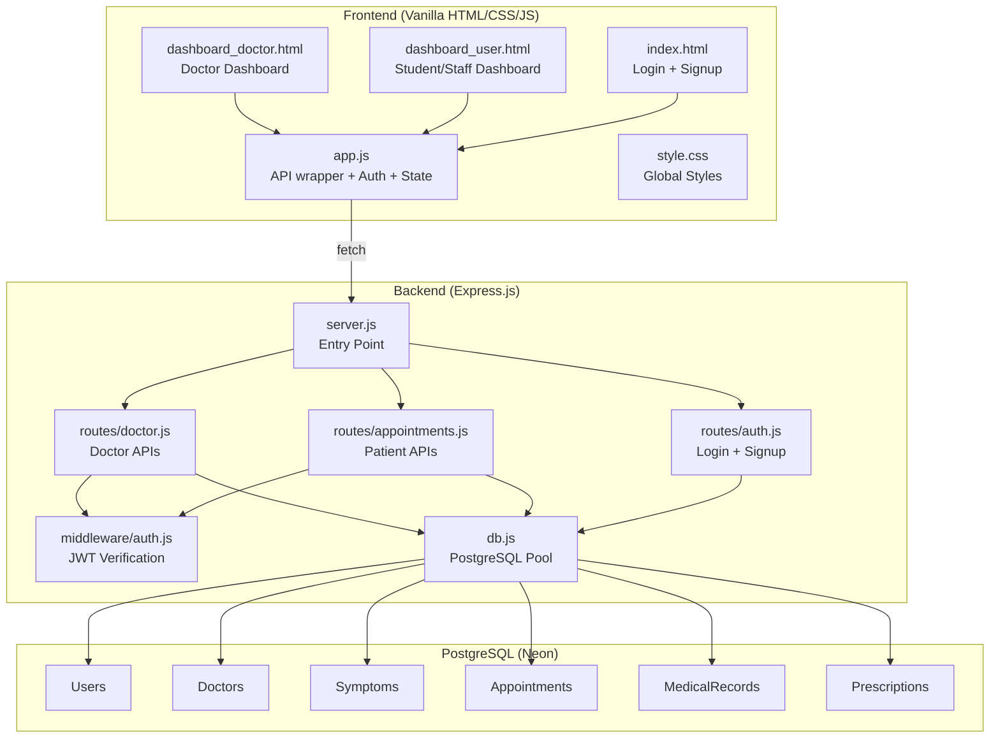
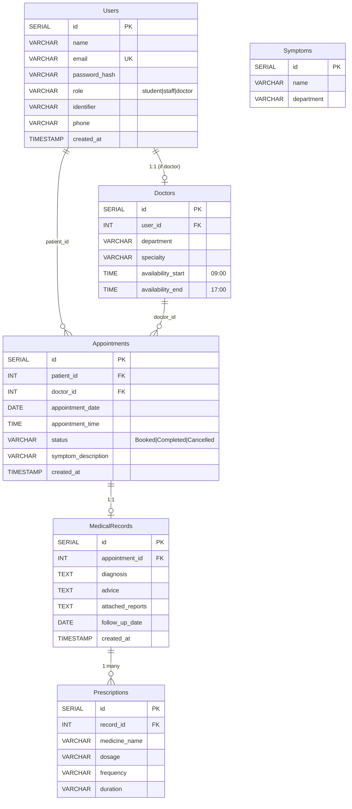
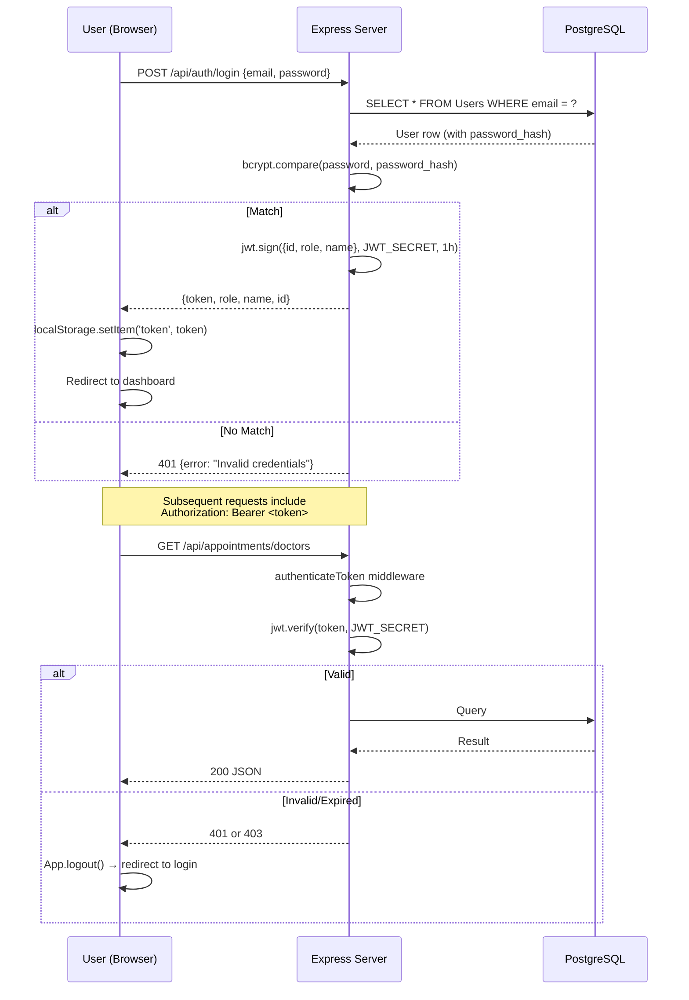
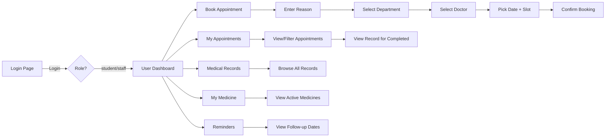
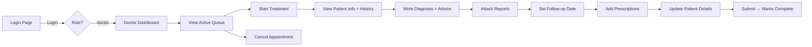
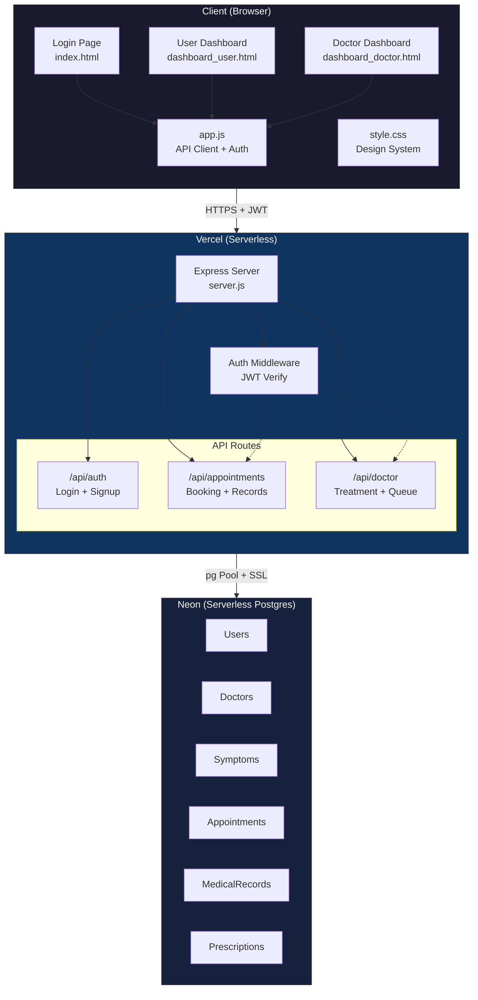

# KAPS MedTech — Project Analysis

> **Phase 1: Repository Discovery**
> Generated: 2026-07-13
> Analyst: AI Engineering Team

---

## 1. Project Overview

**KAPS MedTech** is a university healthcare management system that connects students and staff with on-campus doctors. It was built during a hackathon ("KAPS Hackathon") and subsequently refined through ~8 commits.

### Purpose
- Provide a centralized platform for university healthcare services
- Enable students/staff to book appointments with doctors across 13 medical departments
- Allow doctors to manage patient queues, write diagnoses, and issue digital prescriptions
- Track active medications with auto-expiry logic
- Maintain digital medical records and follow-up reminders

### Target Users
| Role | Description |
|------|-------------|
| **Student** | University students who need medical consultations |
| **Staff** | University staff members with the same healthcare access as students |
| **Doctor** | University-affiliated physicians across 13 departments |

### Business Workflow
1. Student/Staff **signs up** or **logs in**
2. User **describes symptoms** and **selects a department**
3. User **picks a doctor** from the selected department
4. User **selects a date and available time slot** → appointment booked
5. Doctor **views their appointment queue** (all non-completed appointments)
6. Doctor **starts treatment**: views patient history, writes diagnosis, prescribes medicine, optionally attaches reports (image/PDF as Base64), sets follow-up date
7. Treatment submission **marks appointment as Completed**, creates `MedicalRecord` and `Prescriptions`
8. User can **view medical records**, **active medicines** (with auto-expiry), and **follow-up reminders**

---

## 2. Tech Stack

| Layer | Technology | Version | Notes |
|-------|-----------|---------|-------|
| **Runtime** | Node.js | ≥14 | CommonJS modules |
| **Server Framework** | Express.js | 5.2.1 | Note: Express 5 (beta/RC at time of use) |
| **Database** | PostgreSQL | — | Via Neon (serverless Postgres) in production |
| **DB Driver** | pg (node-postgres) | 8.16.3 | Connection pool with SSL |
| **Auth** | JWT (jsonwebtoken) | 9.0.3 | 1-hour token expiry |
| **Password Hashing** | bcrypt | 6.0.0 | Salt rounds: 10 |
| **Environment** | dotenv | 17.2.3 | Loads from `backend/.env` |
| **CORS** | cors | 2.8.5 | Wide-open (no restrictions) |
| **Frontend** | Vanilla HTML/CSS/JS | — | No framework, no bundler |
| **Font** | DM Sans (Google Fonts) | — | CDN-loaded |
| **Deployment** | Vercel + Neon | — | Serverless Node + Serverless Postgres |

---

## 3. Folder Structure Analysis

```
KAPS_MedTech/
├── .agents/                         # AI skill configuration
│   └── skills/ui-ux-pro-max-skill/  # UI/UX design intelligence skill
├── .git/                            # Version control
├── .gitignore                       # Standard Node.js gitignore
├── DEPLOYMENT.md                    # Deployment guide for Vercel + Neon
├── README.md                        # Project documentation
├── package.json                     # Root package with all deps
├── package-lock.json                # Dependency lockfile
├── vercel.json                      # Vercel deployment configuration
│
├── backend/
│   ├── server.js                    # Express entry point (46 lines)
│   ├── db.js                        # PostgreSQL pool configuration (16 lines)
│   ├── schema.sql                   # DDL + seed data (254 lines)
│   ├── init_db.js                   # Schema executor script (21 lines)
│   │
│   ├── middleware/
│   │   └── auth.js                  # JWT verification middleware (18 lines)
│   │
│   ├── routes/
│   │   ├── auth.js                  # Login + Signup (91 lines)
│   │   ├── appointments.js          # Patient-facing CRUD (256 lines)
│   │   └── doctor.js                # Doctor-facing CRUD (139 lines)
│   │
│   ├── data/
│   │   └── store.json               # UNUSED — legacy flat-file data store
│   │
│   ├── diagnose.js                  # Debug: env + DB connection checker
│   ├── debug_hash.js                # Debug: bcrypt hash verification
│   ├── debug_records.js             # Debug: completed appointments check
│   ├── debug_records_full.js        # Debug: all appointments/records dump
│   ├── debug_user.js                # Debug: appointment owner lookup
│   ├── generate_hash.js             # Debug: generate bcrypt hash
│   ├── reset_pwd.js                 # Debug: reset specific user's password
│   ├── test_cardio_login.js         # Debug: test cardio doctor login
│   ├── test_db.js                   # Debug: test doctor insert (BROKEN — uses Supabase API)
│   ├── test_doctor_signup.js        # Debug: test doctor signup flow
│   ├── test_endpoint.js             # Debug: test record endpoint
│   └── test_medicine_expiry.js      # Debug: test medicine expiry logic
│
└── frontend/
    ├── index.html                   # Login/Signup page (294 lines)
    ├── dashboard_user.html          # Student/Staff dashboard (465 lines)
    ├── dashboard_doctor.html        # Doctor dashboard (322 lines)
    │
    ├── css/
    │   └── style.css                # Global stylesheet (313 lines)
    │
    ├── js/
    │   └── app.js                   # Shared app logic: API, auth, routing (83 lines)
    │
    └── img/
        └── logo.png                 # App logo (411 KB)
```

### Key Observations
- **9 debug/test files** in `backend/` root — development artifacts left in production code
- **1 dead data file** (`data/store.json`) — remnant from an earlier flat-file architecture
- **No separation** between page-specific JS and shared JS — all page logic is inline `<script>` blocks
- **All CSS in one file** + extensive inline `<style>` blocks in each HTML page
- **No build process** — raw files served directly

---

## 4. Component Relationships



---

## 5. API Flow

### Endpoints

| Method | Route | Auth | Role | Description |
|--------|-------|------|------|-------------|
| `POST` | `/api/auth/signup` | No | Any | Register new user (student/staff/doctor) |
| `POST` | `/api/auth/login` | No | Any | Authenticate, returns JWT |
| `GET` | `/api/health` | No | Any | DB connection health check |
| `GET` | `/api/appointments/symptoms` | No | Any | Search symptoms (ILIKE) |
| `GET` | `/api/appointments/doctors` | JWT | Any | List doctors by department |
| `GET` | `/api/appointments/slots` | JWT | Any | Get available time slots for a doctor+date |
| `POST` | `/api/appointments/book` | JWT | Any | Book an appointment |
| `GET` | `/api/appointments/my-appointments` | JWT | Patient | List user's appointments (filterable) |
| `GET` | `/api/appointments/medical-records` | JWT | Patient | Get user's medical records |
| `GET` | `/api/appointments/:id/record` | JWT | Any | Get single record by appointment ID |
| `GET` | `/api/appointments/my-medicine` | JWT | Patient | Active medicines (auto-expiry) |
| `GET` | `/api/appointments/reminders` | JWT | Patient | Future follow-up reminders |
| `PUT` | `/api/appointments/:id/reschedule` | JWT | Any | Reschedule appointment date/time |
| `GET` | `/api/doctor/today` | JWT | Doctor | Doctor's active appointments |
| `GET` | `/api/doctor/patient/:id` | JWT | Doctor | Patient info + medical history |
| `POST` | `/api/doctor/record` | JWT | Doctor | Submit diagnosis + prescriptions |
| `POST` | `/api/doctor/cancel` | JWT | Doctor | Cancel an appointment |

---

## 6. Database Schema



### Seed Data
- **65 doctors** across 13 departments (5 per department)
- **48 symptoms** mapped to departments
- All doctors share the same bcrypt hash for `password123`

---

## 7. Authentication Flow



### Key Design Decisions
- JWT stored in `localStorage` (not httpOnly cookies)
- Token carries `{id, role, name}` — role-based routing happens client-side
- No token refresh mechanism — hard 1-hour expiry
- JWT secret fallback to `'secret'` if env var is missing (security risk)

---

## 8. User Flow

### Student/Staff Flow


### Doctor Flow


---

## 9. Existing Strengths

| # | Strength | Details |
|---|----------|---------|
| 1 | **Well-structured SQL schema** | Proper foreign keys, CASCADE constraints, CHECK constraints on role/status |
| 2 | **Transaction usage** | Signup and doctor record submission use `BEGIN/COMMIT/ROLLBACK` |
| 3 | **JWT authentication** | Standard Bearer token pattern with middleware |
| 4 | **Role-based authorization** | `requireDoctor` middleware on doctor routes |
| 5 | **Parameterized queries** | All SQL uses `$1, $2...` parameters — prevents SQL injection |
| 6 | **Bcrypt for passwords** | Industry-standard hashing with salt rounds |
| 7 | **Auto-expiry logic** | Medicine cabinet intelligently hides expired prescriptions |
| 8 | **Multi-step booking wizard** | Clean UX flow: reason → department → doctor → date → slot |
| 9 | **Dark theme design system** | CSS variables, consistent visual language |
| 10 | **Clean deployment config** | Vercel + Neon setup is well-documented and functional |
| 11 | **Health check endpoint** | `/api/health` for monitoring |
| 12 | **Vercel-compatible export** | `module.exports = app` with conditional `listen()` |
| 13 | **Comprehensive seed data** | 65 doctors, 48 symptoms across 13 departments |

---

## 10. Existing Weaknesses

| # | Category | Issue | Severity |
|---|----------|-------|----------|
| 1 | **Dead Code** | 9 debug/test files in backend root | Medium |
| 2 | **Dead Code** | `data/store.json` is unused legacy | Low |
| 3 | **Dead Code** | `test_db.js` uses Supabase API (wrong driver) | Low |
| 4 | **Security** | JWT fallback to `'secret'` if env var missing | Critical |
| 5 | **Security** | CORS wide open (`app.use(cors())`) | High |
| 6 | **Security** | Token in localStorage (XSS vulnerability) | Medium |
| 7 | **Security** | `reset_pwd.js` has hardcoded personal email | Medium |
| 8 | **Security** | No rate limiting on login/signup | High |
| 9 | **Security** | All seed doctors share same password hash | Medium |
| 10 | **Security** | Error messages expose internal DB details (`err.message`, `err.code`) | High |
| 11 | **Architecture** | All page JS is inline in HTML files | High |
| 12 | **Architecture** | No input validation on backend (beyond basic field presence) | High |
| 13 | **Architecture** | No logging framework (only `console.error`) | Medium |
| 14 | **Architecture** | `express.json({ limit: '50mb' })` — extremely high | Medium |
| 15 | **Architecture** | Base64 file storage in DB `TEXT` column | High |
| 16 | **Authorization** | `/api/appointments/:id/record` doesn't verify ownership | Critical |
| 17 | **Authorization** | `/api/appointments/:id/reschedule` doesn't verify ownership | Critical |
| 18 | **Authorization** | `/api/doctor/cancel` doesn't verify doctor owns appointment | High |
| 19 | **Frontend** | No loading/skeleton states (just "Loading..." text) | Medium |
| 20 | **Frontend** | No empty state designs | Medium |
| 21 | **Frontend** | No error feedback UI (uses `alert()`) | High |
| 22 | **Frontend** | Not responsive (split layout breaks on mobile) | High |
| 23 | **Frontend** | Inline styles throughout HTML | Medium |
| 24 | **Frontend** | `mb-8` class used in HTML but not defined in CSS | Low |
| 25 | **Database** | No indexes beyond primary keys | Medium |
| 26 | **Database** | `attached_reports` as TEXT (Base64) — scales poorly | High |
| 27 | **Database** | `ssl: { rejectUnauthorized: false }` hardcoded | Medium |
| 28 | **Database** | `dotenv.config()` called in multiple files | Low |
| 29 | **Performance** | Doctor `/today` loads ALL non-completed (not date-filtered) | Medium |
| 30 | **UX** | `window.location.reload()` after booking | Low |
| 31 | **UX** | No confirmation modal before actions (uses browser `confirm()`) | Medium |
| 32 | **UX** | No pagination on any list | Medium |
| 33 | **Testing** | No automated tests | High |
| 34 | **Documentation** | No API reference | Medium |
| 35 | **Documentation** | No architecture docs | Medium |

---

## 11. Overall Architecture Diagram



---

## 12. Summary

KAPS MedTech is a competently structured hackathon project with a solid database schema, sensible business logic, and working end-to-end flows. The core workflow — appointment booking through diagnosis — functions correctly.

However, it carries the hallmarks of rapid development:
- **Security gaps** in authorization, error exposure, and JWT configuration
- **No separation of concerns** on the frontend (monolithic HTML files with inline scripts)
- **Dead development artifacts** scattered through the backend
- **No automated tests** or structured error handling
- **Missing responsive design** and modern UX patterns

The codebase is small (~2,800 lines across all source files) and well-scoped, making it an excellent candidate for systematic improvement without requiring a rewrite.
